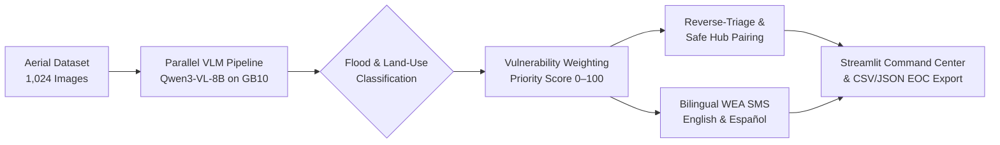

# 🚨 FloodPulse AI — Autonomous Aerial Disaster Triage & Dispatch System

**Dell Social Impact AI Datathon: Team Four Squared** — *AI-powered post-flood aerial triage, responder protection, and bilingual emergency dispatch built on NVIDIA GB10.*


---

## Overview

**FloodPulse AI** addresses the critical bottleneck emergency dispatchers face after major hurricanes and flash floods: manually reviewing thousands of aerial images while coordinating rescues under severe time pressure. Developed by **Team Four Squared** for the **Dell Social Impact AI Datathon**, the platform runs `qwen3-vl-8b-instruct` on **NVIDIA GB10** to scan aerial imagery at scale, separate natural waterways from muddy floodwater, prioritize densely populated neighborhoods, prevent first-responder casualties via **Reverse-Triage**, and generate instant bilingual (English & Spanish) citizen alerts.

---

## Objectives & Key Capabilities

- **3-Tier Visual Flood Triage (`VERY DANGEROUS` / `DANGEROUS` / `SAFE`)**: Distinguishes normal rivers, bayous, and ponds within natural banks from muddy floodwater covering roadways, vehicles, and structures.
- **Dynamic Land-Use Vulnerability Scoring (`0–100 Priority Score`)**: Infers surrounding land use (`Dense Urban / Commercial`, `Suburban Residential`, `Highway / Transit Corridor`, `Rural / Agricultural`) directly from visual evidence to weight flood severity by population density.
- **Reverse-Triage & Safe Hub Pairing**: Blocks standard ambulances and light vehicles from entering life-threatening floodwaters (`VERY DANGEROUS`) to prevent secondary responder casualties, while pairing each critical zone with an AI-verified `SAFE` staging hub.
- **Bilingual WEA/SMS Alerts & Human-in-the-Loop (HITL)**: Auto-generates localized citizen evacuation alerts in **English and Spanish**, and flags low-confidence detections (`needs_human_review`) for dispatcher verification.
- **Tactical Q&A & Before vs. After Damage Assessment**: Enables operators to query live aerial feeds or compare pre-flood baseline and post-event frames to identify newly submerged infrastructure.

---

## Technology Stack

| Category | Tools |
| :--- | :--- |
| **Language** | Python 3.12 |
| **Vision-Language Model** | `qwen3-vl-8b-instruct` hosted on NVIDIA GB10 (`OpenAI`-compatible inference API) |
| **Parallel Processing** | `concurrent.futures.ThreadPoolExecutor`, `Pillow` (image resizing & Base64 encoding), atomic JSON/CSV checkpointing |
| **Command Center UI** | Streamlit (5-tab operational dashboard with live VLM Q&A and report exports) |
| **Collaboration** | GitHub & JupyterHub server environment |

---

## Data Sources & Vulnerability Scoring

1. **Post-Flood Aerial Dataset (1,024 Images)**: High-resolution post-event aerial frames processed in parallel from the datathon server dataset (`/tmp/datathon/UTSA-flood-images-complete/images`).
2. **GIS-Inspired Land-Use Vulnerability Layer**: Combines VLM-detected visual flood severity (`0–70`) with land-use population density multipliers to compute a **0–100 Priority Score**:
   - **Dense Urban / Commercial (`×1.45`)** — ~5,500 residents/sq mi
   - **Suburban Residential (`×1.30`)** — ~3,400 residents/sq mi
   - **Highway / Transit Corridor (`×1.25`)** — Critical evacuation artery
   - **Rural / Agricultural (`×1.15`)** — ~1,200 residents/sq mi

---

## System Architecture



- **Ingestion & Inference (`flood_triage_pipeline.ipynb`)**: Resizes aerial frames, enforces strict JSON schema responses from `qwen3-vl-8b-instruct` with thinking disabled for low latency, and writes incremental atomic checkpoints to prevent data loss.
- **Decision & Dispatch Layer (`app.py`)**: Ranks all 1,024 sectors by Priority Score, enforces Reverse-Triage vehicle restrictions, pairs critical sectors with dry `SAFE` hubs, and exposes interactive live-upload triage and Before/After comparison tools.

---

## Getting Started (Jupyter / Server Environment)

1. **Clone the repository and install dependencies:**
   ```bash
   git clone [https://github.com/yaroslavkosenkov/floodpulse-ai.git](https://github.com/yaroslavkosenkov/floodpulse-ai.git)
   cd floodpulse-ai
   pip install -r requirements.txt
   ```

2. **(Optional) Re-run the full 1,024-image batch triage pipeline:**
   Open `flood_triage_pipeline.ipynb` in Jupyter and run all cells to regenerate `triage_report.json` and `triage_report.csv` from `/tmp/datathon/UTSA-flood-images-complete/images` (pre-computed reports for all 1,024 images are already included in this repository).

3. **Launch the Streamlit Command Center:**
   ```bash
   python3 -m streamlit run app.py --server.port 8501 --server.headless true
   ```
   *When running on JupyterHub, open the dashboard via your `/proxy/8501/` route (or `http://localhost:8501` locally).*

---

## Repository Contents

| File | Description |
| :--- | :--- |
| `flood_triage_pipeline.ipynb` | Parallel VLM batch-triage notebook (`ThreadPoolExecutor` + atomic checkpointing) that scans all 1,024 aerial images and generates ranked reports. |
| `app.py` | Standalone Streamlit Command Center featuring priority queues, reverse-routing dispatch plans, full CSV/JSON report tables, live image Q&A on GB10, and Before/After comparison. |
| `triage_report.json` | Complete ranked JSON output across all 1,024 processed aerial sectors. |
| `triage_report.csv` | Tabular dispatch report ready for Emergency Operations Center (EOC) and GIS ingestion. |
| `requirements.txt` | Required Python dependencies (`openai`, `pillow`, `streamlit`). |
| `README.md` | Project overview, system architecture, and setup documentation. |

---

## Project Status

**Completed.** All 1,024 aerial images have been processed and ranked, structured dispatch outputs (`triage_report.json` and `triage_report.csv`) are generated, and the interactive Streamlit Command Center is operational.

---

## Team — Team Four Squared

- **Yaroslav Kosenkov** — System Architecture, VLM Triage Pipeline, Vulnerability Scoring Logic & Streamlit Command Center
- **Nathaniel Venzor** — Team Coordinator, Documentation & Primary Presenter
- ****

---

## Acknowledgments

**Dell Social Impact AI Datathon — Team Four Squared (Group 16)** (UTSA & NVIDIA GB10 Inference Infrastructure)
